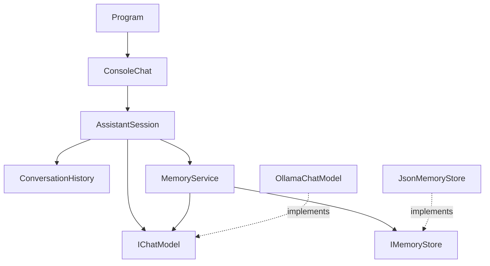

# Zeya architecture

Zeya is one application organized by responsibility. The `Lab_2` directory
keeps its academic placement; the project, assembly, and namespaces describe
the assistant itself. `Zeya.slnx` groups the app and its checks.

## Responsibilities

| Folder / namespace | Main types | Responsibility |
| --- | --- | --- |
| `Configuration` / global namespace | `AssistantSettings` | Shared model name, Ollama endpoint, and timeout. |
| `ConsoleUI` / `Zeya.ConsoleUI` | `ConsoleChat` | Read input, handle commands, and display responses or errors. |
| `Assistant` / `Zeya.Assistant` | `AssistantSession`, `ConversationHistory`, `AssistantReply`, `Toolbox` | Coordinate a conversation, local tool calls, and memory. |
| `Chat` / `Zeya.Chat` | `IChatModel`, `ChatMessage`, `TokenizerRegistry`, `ModelTokenCounter` | Define chat contracts, register tokenizer files, and count message tokens. |
| `Chat/Ollama` / `Zeya.Chat.Ollama` | `OllamaChatModel`, `OllamaChatResponse` | Translate chat requests into Ollama HTTP calls. |
| `Memory` / `Zeya.Memory` | `MemoryService`, `IMemoryStore`, `MemoryFact`, `MemoryUpdate` | Extract lasting facts and describe memory changes. |
| `Memory/Storage` / `Zeya.Memory.Storage` | `JsonMemoryStore` | Resolve the default memory location, validate changes, and persist facts to JSON. |

`Program.cs` is the composition root: it creates those objects and connects
their dependencies. It contains startup only. Constructors show exactly what
each service needs; there is no dependency-injection framework.

## Dependency flow

The console knows the assistant session and the memory file's display path.
It does not build model prompts, trim conversation history, or write files.
The assistant session knows the chat contract and the memory service; it does
not use `Console`, HTTP, or file APIs. The memory service uses `IChatModel` and
`IMemoryStore`, so it does not depend on the Ollama provider or JSON implementation.

`AssistantInstructions` contains Zeya's conversational behavior.
`MemoryPrompts` contains extraction rules and the structured response schema.
`MemoryJson` supplies the shared serialization rules for facts and proposals.

Zeya compiles the three Lab 1 logging classes from their original files.
`TokenizerRegistry` maps model names to tokenizer files. `ModelTokenCounter`
loads the registered file at construction and counts tokens. The Ollama adapter
uses it for token budgets and logs the latest user-role message's exact count
when available. It also logs the request size, Ollama's reported token counts,
elapsed time, and read or connection errors.
`AssistantSession` logs conversation updates, dropped
exchanges, and tool errors. The adapter attaches metrics to the returned
`ChatMessage`. JSON serialization excludes them, so the wire format stays
limited to role and content.

## One user message

1. `ConsoleChat` reads input and handles terminal commands locally.
2. `AssistantSession.ReplyAsync` captures recent memory context and builds a
   request with instructions, saved facts, and the current user message.
3. `IChatModel.ChatAsync` produces text or requests a tool with a JSON object.
   The session runs the tool and adds its result to the current request before
   asking the model again. The intermediate messages stay within that request.
   On success, the user message and final reply join history together.
4. An `AssistantReply` carries the response text, original user message, and
   previous-message snapshot back to the console for display.
5. `AssistantSession.SaveMemoriesAsync` passes that snapshot to
   `MemoryService.ExtractAndSaveAsync`. A separate structured model request
   proposes add/update/delete actions.
6. `IMemoryStore.ApplyUpdatesAsync` validates the batch and persists changes.
   JSON/data validation failure permits one repair request in `MemoryService`;
   the same checks apply again. Network/file errors are reported directly.
   A memory failure does not discard the chat reply.

`ConversationHistory` owns the completed exchanges. Startup creates one history
per session with `Tier1()`, `Tier2()`, or `Tier3()`. After accounting for the
current turn, instructions, and saved facts, `AssistantSession` asks history
for the newest complete exchanges that fit 50%, 75%, or 100% of the remaining
prompt budget. Tool follow-ups use the same calculation with the tool messages
included. `IChatModel` supplies the prompt budget and per-message token estimates.
`MemoryService` gives earlier messages a separate 512-token extraction budget.
Successful forgetting clears the conversation history.

## Memory data and persistence

- `MemoryFact`: one stored fact, its scope, evidence, ID, and update time.
- `MemoryUpdate`: one model-proposed operation; `Action` remains the JSON field
  used by the extraction schema.
- `MemoryUpdateBatch`: the model's list of proposed actions.
- `MemoryChangeSummary`: counts of additions, updates, and deletions.

`JsonMemoryStore` keeps the validation and persistence transaction together.
It checks evidence, IDs, field lengths, duplicates, scope changes, and capacity
before publishing a new state. It writes a temporary file, replaces the target
file, and only then updates its in-memory facts. Invalid batches and failed
writes do not partly modify the saved collection.

Existing files retain the same camel-case fields and default location under
`%LOCALAPPDATA%\Zeya`. Moving or renaming C# types requires no memory migration.
The implementation supports one running instance per memory file.

## Error handling

Internal code follows offensive programming: constructor dependencies and API
arguments are checked at entry, and invalid conversation state or a broken
`IChatModel` implementation throws `InvalidOperationException`. The console
does not catch those programming failures. Session history changes only after a
successful chat turn. Missing memory on first startup, bad
commands, invalid model JSON, and file/network failures remain expected cases.
Model repair handles rejected data only; it does not repair contract violations.
Startup file/data errors print their cause and exit with code 1.

Each session, memory service, memory store, and console loop rejects overlapping
operations. A session accepts only its own latest unsaved `AssistantReply` for
memory processing; stale or consumed results fail before any model/file work.
The reply owns a read-only context snapshot. Change summaries reject negative
counts and overflow, and serializer options are frozen after construction.

Same-scope fact updates must share a nongeneric subject word. This rejects
obvious unrelated replacements as external proposal errors, allowing one repair
attempt. It is a conservative lexical rule and may reject valid paraphrases;
semantic correctness still depends on the model. All source review decisions,
including transport records retained without constructor guards, are listed in
`OFFENSIVE_REVIEW.md`.

## Extending Zeya

- Another model provider implements `IChatModel` and is connected in `Program.cs`.
- Another persistent memory implementation implements `IMemoryStore`.
- Another user interface calls `AssistantSession` instead of copying console logic.
- Built-in tools live in `Toolbox`. The session owns the JSON protocol and
  enforces a three-attempt budget per question.

Checks live in `Zeya.Checks`. They use real temporary JSON files, stub HTTP
responses, and a recording `IChatModel` to exercise service boundaries.
Current verification results and the remaining live-model limitation are in
`README.md`.
